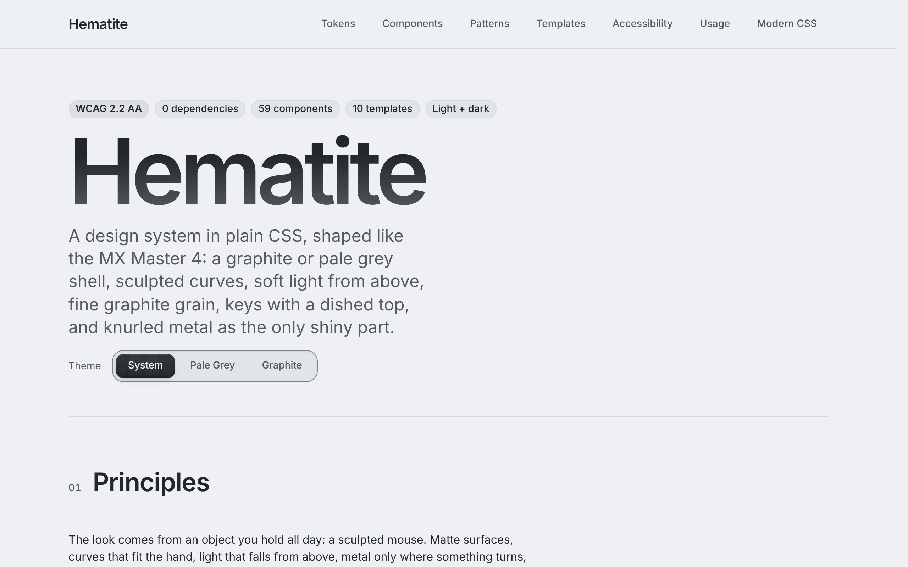
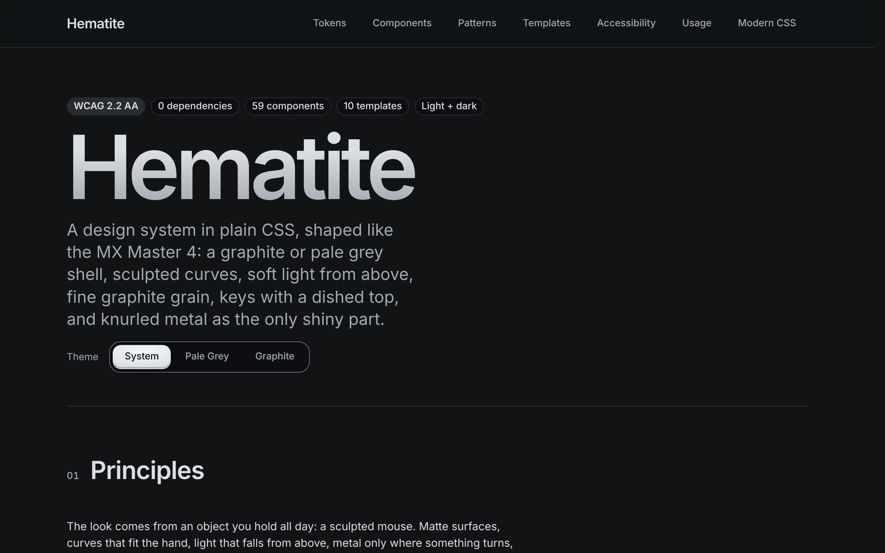
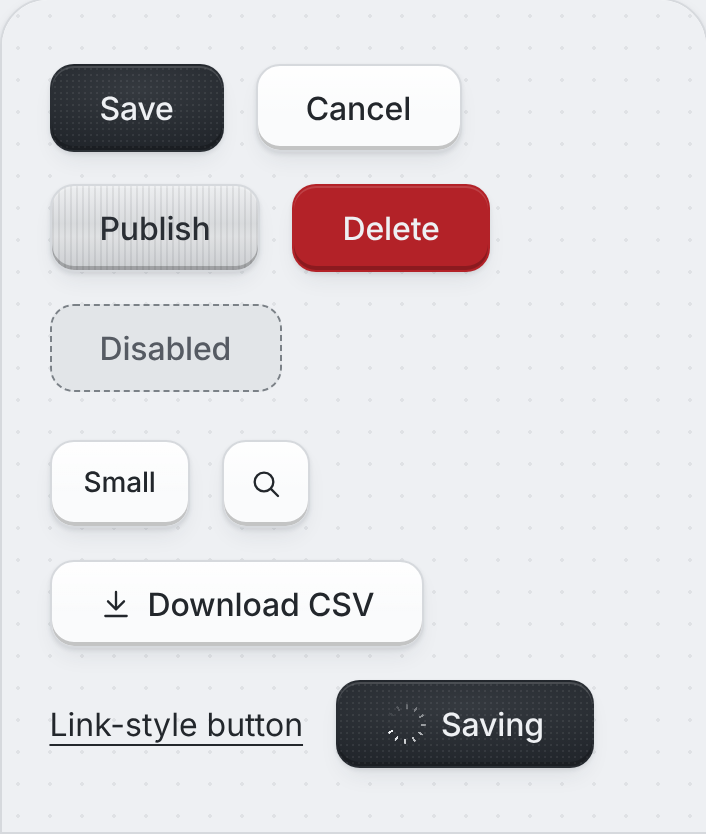
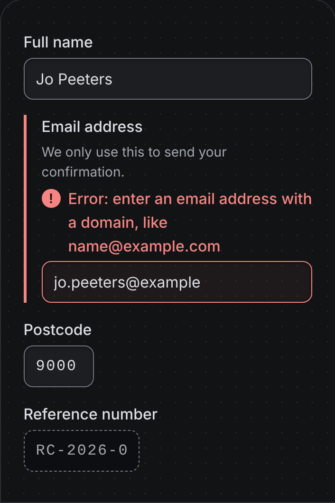
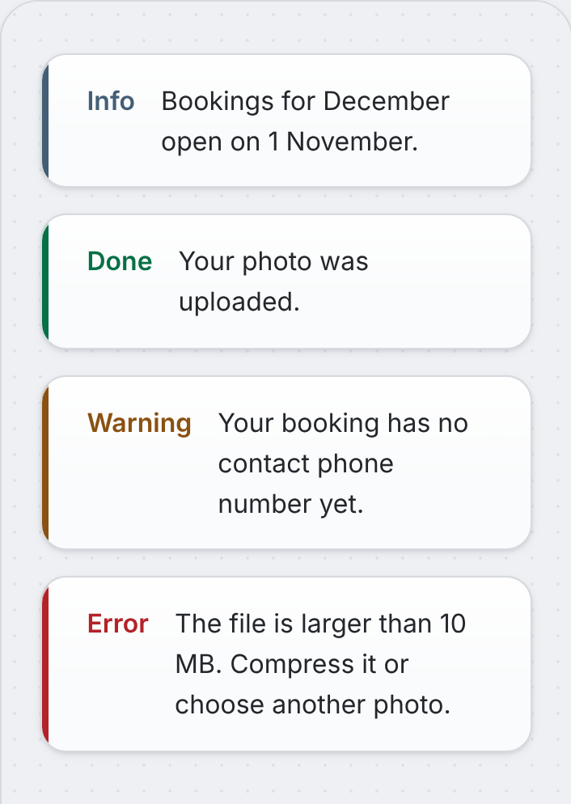
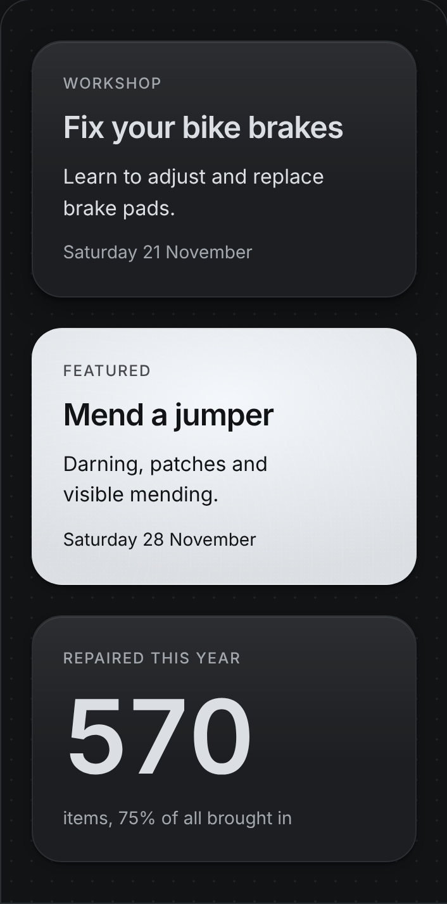
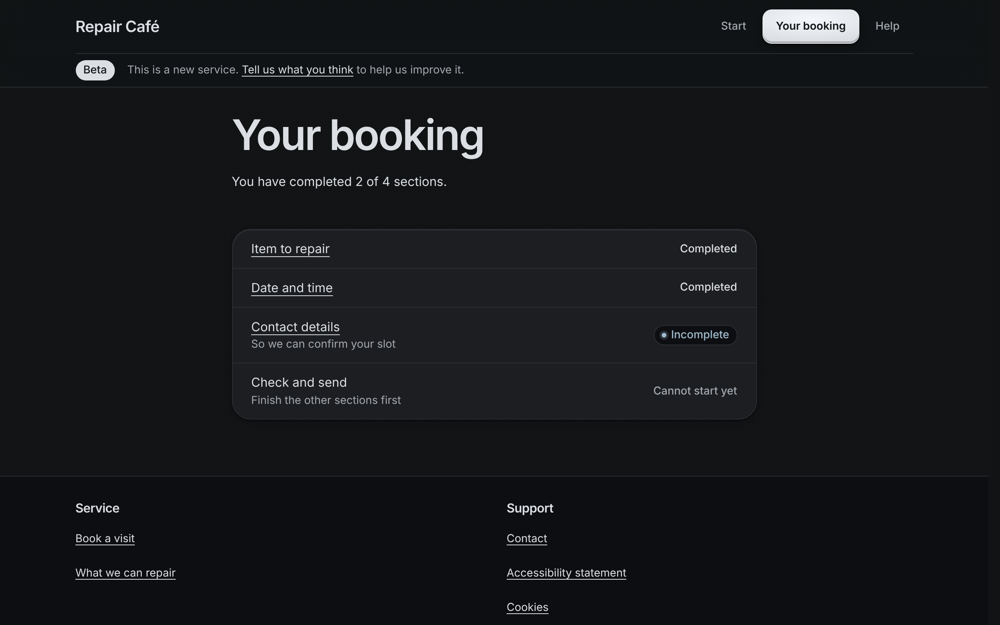

# Hematite design system

Hematite is a dark grey stone with a metallic sheen: graphite that catches the light.

Zero-dependency design system in plain CSS, with the look of the Logitech MX Master 4: a matte
graphite or pale grey shell with a fine grain, sculpted curves, soft light from above, keys with a
dished top, and knurled metal as the only shiny part. Targets WCAG 2.2 level AA.

Hematite keeps the structure of [Formwork](https://github.com/KobeBrandt/formwork) (same classes,
same HTML, same components, patterns and templates) and replaces its brutalist skin. A page built
on Formwork switches by changing the stylesheet and script names. Not affiliated with Logitech:
the mouse is a design reference, and no logo, name or product image is used.

| Pale Grey | Graphite |
|-----------|----------|
|  |  |
|  |  |
|  |  |



## Documentation

The documentation is the site itself: open `index.html` in a browser (serve the folder, for
example with `python3 -m http.server`, because the icon sprite does not load over `file://`).
It is also published at **https://kobebrandt.github.io/hematite/** once GitHub Pages is switched on
for this repository (the workflow in `.github/workflows/pages.yml` deploys every push to `main`).

## Quick start

```html
<!doctype html>
<html lang="en">
<head>
  <meta charset="utf-8">
  <meta name="viewport" content="width=device-width, initial-scale=1">
  <link rel="stylesheet" href="css/hematite.css">
  <script src="js/hematite.js" defer></script>  <!-- optional -->
</head>
<body>
  <main class="container stack">
    <h1>Hello</h1>
    <button class="button" type="button">Save</button>
  </main>
</body>
</html>
```

Or copy a page from `templates/` and change it.

## The look

| From the mouse          | In the system |
|-------------------------|---------------|
| Graphite and Pale Grey  | Dark and light themes: `--color-bg`, `--color-surface` (raised), `--color-sunken` (recessed) |
| Sculpted, hand-shaped   | No sharp corners: keys at 0.75rem, cards up to 1.5rem, concentric when nested |
| Soft-touch matte shell  | Hairline edges, a 1px top sheen and three soft shadows (`--shadow-1/2/3`) |
| MagSpeed metal wheel    | `--gradient-metal` and `--texture-knurl`: the main call to action, progress, slider thumbs |
| The status light        | No brand colour: knurled metal for the main action, a small green light for the current item |
| Keys and haptic clicks  | Buttons are graphite keys (`--gradient-key`, `--shadow-key`) that sink on press; switches overshoot a touch (`--ease-snap`) |
| Free-spinning scroll    | `--ease`: a fast start and a long soft stop |
| Options+ app            | Segmented controls for tabs and toggles, floating graphite toasts |
Grounded in UI-design principles (Gestalt, CRAP, Nielsen's heuristics), CSS architecture
(BEM, OOCSS, Atomic design) and accessibility practice. Components, patterns and templates
were checked against the GOV.UK Design System, the Vlaanderen design system and the
US Web Design System.

## What is in it

- 59 components: forms (error summary, date input, password, file upload, character count…),
  feedback (alert, notification banner, panel, toast, progress…), navigation (pagination,
  side nav, step indicator, task list, tabs…), content, data and page furniture.
- 16 patterns (asking for names, dates, addresses; check answers; error pages…) and writing rules.
- 10 page templates in `templates/` for an example service.
- 39 icons in `icons/hematite-icons.svg`.
- An optional 5 KB (gzipped) script, `js/hematite.js`. Every component works without it.

## Files

```
css/
  hematite.css        entry: imports everything into cascade layers
  tokens.css          colour, type, space, shape, z-index, motion, breakpoints
  base.css            reset, elements, focus
  layout.css          container, stack, cluster, grid, sidebar, switcher
  components.css      imports the files below
  components/
    actions.css       skip link, button, button group, back link, exit page
    forms.css         inputs, checks, field, error summary, date, search, upload…
    feedback.css      badge, alert, notification, panel, loader, progress, toast…
    content.css       prose, lists, card, icon, quote, figure, contact, chart…
    data.css          table, summary list
    navigation.css    breadcrumb, pagination, side nav, steps, task list…
    interactive.css   disclosure, accordion, tabs, dialog, tooltip, popover
    page.css          site header, footer, cookie banner, sticky bar
  utilities.css       helpers
  print.css           print styles
js/hematite.js        optional enhancements
icons/                SVG sprite
templates/            example pages
index.html            documentation: overview and principles (open it next to the folders)
docs/                 the other documentation pages
  tokens.html         colour, type, space, shape, motion
  components.html     index of all components, then one page per group:
  components-*.html   actions, forms, feedback, content, data, navigation, show-and-hide, page
  patterns.html  templates.html  accessibility.html  usage.html  modern-css.html
  docs.css, docs.js   styles and script for the documentation only
tools/check-contrast.py checks every colour pair stays between its floor and 15:1
tools/check-a11y.mjs  runs axe on every page in both themes (CI runs both checks)
tools/build-docs.py   copies the docs to dist/ with scripts inlined, for hosts whose
                      Content-Security-Policy blocks script files
```

## Use

```html
<link rel="stylesheet" href="css/hematite.css">
<script src="js/hematite.js" defer></script>  <!-- optional -->
```

- Naming: BEM (`.block__element--modifier`). Each component is tagged Atom, Molecule or Organism.
- Every file sits in a cascade layer (`hematite.tokens` … `hematite.print`), so your own
  unlayered CSS always wins without `!important`. The same goes for an unlayered reset from a
  CMS or host page: if it sets `body { background: #fff }`, dark mode breaks. Put such a reset in
  a layer declared before Hematite, or restate `body { background: var(--color-bg); color: var(--color-ink); }`.
- Theme: override tokens, never component rules. Colour tokens are `light-dark(light, dark)`
  pairs. Dark mode follows the OS; set `data-theme="light"` or `"dark"` on `<html>` to pin one,
  or add `.theme-dark` / `.theme-light` to a single block.
- Units are rem (breakpoints in em); colours are oklch.
- Right to left works through logical properties: set `dir="rtl"` on `<html>`.

## Browser support

Last two versions of Chrome, Edge, Firefox and Safari. Hematite uses Baseline CSS: cascade
layers, nesting, `:has()`, container queries, `light-dark()`, relative colours, `@property` and
`@starting-style`. Newer features (anchor positioning, `field-sizing`) are enhancements only.
`light-dark()` has a media-query fallback. The docs page lists every feature and its status.

See `CHANGELOG.md` for releases and `CONTRIBUTING.md` to add a component.

## Credits

Hematite is a re-skin of [Formwork](https://github.com/KobeBrandt/formwork), which supplies the
structure, components, patterns, templates and accessibility work. The visual reference is the
Logitech MX Master 4 and the MX desk range; Hematite is an independent project, not made or
endorsed by Logitech, and contains no Logitech logos, names in the UI or product images.

## License

[MIT](LICENSE)

